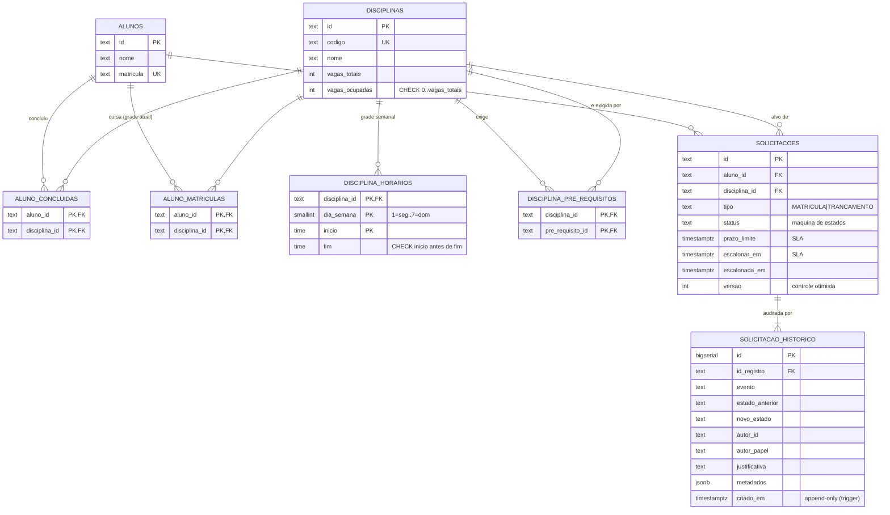
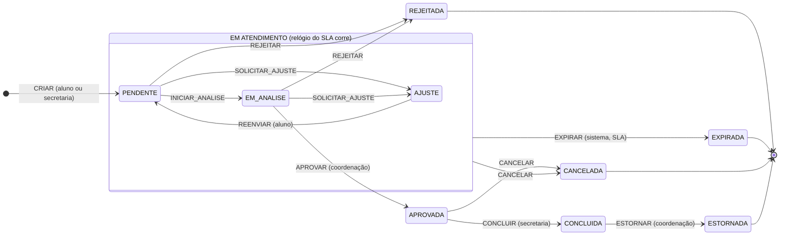

# Matrícula / Trancamento — Terceiro Trabalho Avaliativo

Evolução da Atividade 1 (NestJS + Next.js) para um fluxo com **máquina de estados explícita**, **RBAC por estado**,
**guardas de transição**, **concorrência**, **SLA**, **compensação (estorno)** e **trilha de auditoria transacional**.

```
atividade1_ppw_server/   API NestJS (Clean Architecture: domain / application / infrastructure / presentation)
atividade1_ppw_client/   Front Next.js
db/                      schema.sql + seed.sql (PostgreSQL)
docker-compose.yml       sobe o PostgreSQL
scripts/                 teste de fumaça de concorrência sobre HTTP
docs/ai-decisions.md     registro crítico do uso de IA   (índice em AI-LOG.md)
```

## Como subir o ambiente

**Opção A — com PostgreSQL (recomendada; é onde valem ACID e locks reais)**

```bash
docker compose up -d                       # cria o banco, aplica db/schema.sql e db/seed.sql

cd atividade1_ppw_server
cp .env.example .env                       # PERSISTENCE=postgres, DATABASE_URL, SLA_*
npm install
npm run start:dev                          # API em http://localhost:3001

cd ../atividade1_ppw_client
cp .env.example .env.local                 # se ainda não existir
npm install
npm run dev                                # front em http://localhost:3000
```

Recomeçar do zero: `docker compose down -v && docker compose up -d`.

**Opção B — sem Docker:** `PERSISTENCE=memory` (padrão quando a variável não existe). Mesmas regras; as transações são
simuladas por `InMemoryUnitOfWork` (fila + snapshot/rollback).

**Testes**

```bash
cd atividade1_ppw_server
npm test                  # unitários: domínio + casos de uso (usa memória, não precisa de banco)
npm run test:e2e          # HTTP completo (memória por padrão; PERSISTENCE=postgres para validar o banco)
node ../scripts/smoke-concorrencia.mjs    # API no ar: duas efetivações simultâneas para a última vaga
npm run docs:states       # imprime o diagrama Mermaid COMPLETO gerado a partir da tabela de regras
```

## Perfis (RBAC)

Não há login. O front tem o seletor **“Atuando como”** e envia `X-Actor-Id` / `X-Actor-Role` a cada requisição
(`ALUNO`, `COORDENADOR`, `SECRETARIA`; `SISTEMA` é interno e rejeitado via HTTP). É uma **simplificação deliberada**:
em produção o `CurrentActor` leria um JWT/sessão e nada mais mudaria, pois o domínio só consome o objeto `Actor`.

## Diagrama Entidade-Relacionamento



Pontos de integridade que o banco impõe sozinho: `CHECK (0 ≤ vagas_ocupadas ≤ vagas_totais)`; índice **único parcial**
`uq_solicitacao_aberta` (no máximo uma solicitação aberta por aluno/disciplina/tipo, mesmo sob corrida); `ON DELETE RESTRICT`
nas FKs de solicitação e trigger que **bloqueia UPDATE/DELETE/TRUNCATE** em `solicitacao_historico`.

## Máquina de estados (simplificado)



`ESCALONAR` (sistema) não aparece acima: mantém o estado (PENDENTE/EM_ANALISE), marca `escalonada_em` e grava a trilha.
O diagrama completo é gerado do código por `npm run docs:states`, então nunca diverge da implementação.

### Matriz RBAC × estado × guardas

| Evento | De → Para | Quem | Guardas (Transition Guards) | Efeito |
|---|---|---|---|---|
| `INICIAR_ANALISE` | PENDENTE → EM_ANALISE | coordenação | prazo não vencido | — |
| `SOLICITAR_AJUSTE` | PENDENTE/EM_ANALISE → AJUSTE_SOLICITADO | coordenação | justificativa | — |
| `REENVIAR` | AJUSTE_SOLICITADO → PENDENTE | aluno (dono) | dono, prazo não vencido, justificativa | reinicia o SLA |
| `APROVAR` | EM_ANALISE → APROVADA | coordenação | prazo, não matriculado/matriculado, **pré-requisitos**, **choque de horário**, **vaga** | — |
| `REJEITAR` | PENDENTE/EM_ANALISE → REJEITADA | coordenação | justificativa | — |
| `CONCLUIR` | APROVADA → CONCLUIDA | **secretaria** | as mesmas guardas de elegibilidade, reavaliadas sob lock | ocupa/libera vaga e altera a grade |
| `CANCELAR` | PENDENTE/EM_ANALISE/AJUSTE/APROVADA → CANCELADA | aluno (dono) ou coordenação | dono, justificativa | nada a desfazer (ainda não efetivada) |
| `ESTORNAR` | CONCLUIDA → ESTORNADA | coordenação | justificativa | **compensação**: devolve vaga/restaura matrícula |
| `ESCALONAR` | PENDENTE/EM_ANALISE → mesmo estado | sistema | escalonamento devido | marca `escalonada_em` |
| `EXPIRAR` | PENDENTE/EM_ANALISE/AJUSTE → EXPIRADA | sistema | prazo realmente vencido | — |

Ordem de resposta de erro: papel sem nenhuma permissão para o evento → **403** (não revela o estado); evento
inexistente no estado atual → **409**; guarda violada → **400**. Quem aprova (coordenação) não efetiva (secretaria): separação de funções.

## Regras de negócio e conflitos assíncronos

* **Concorrência.** `concluir`/`estornar` rodam em UMA transação que trava, sempre na mesma ordem
  (**solicitação → disciplina → aluno**), as linhas com `SELECT … FOR UPDATE`. Duas efetivações para a última vaga são
  serializadas; a segunda reavalia a guarda de vaga já com o COMMIT da primeira e falha. Defesas adicionais:
  `CHECK ck_vagas`, índice único parcial contra pedidos duplicados, e coluna `versao` (controle otimista) no `save`.
* **SLA / temporalidade.** Cada solicitação nasce com `prazo_limite` (7 dias) e `escalonar_em` (3 dias), configuráveis
  (`SLA_PRAZO_DIAS`, `SLA_ESCALONAMENTO_DIAS`). `SlaScheduler` (a cada `SLA_INTERVAL_MS`) e `POST /matriculas/solicitacoes/sla/processar`
  disparam `ESCALONAR`/`EXPIRAR` como **ator SISTEMA**, cada item em sua própria transação (uma falha não trava o lote).
  O relógio só corre antes da aprovação; `REENVIAR` o reinicia. O tempo é um `Clock` injetável (testes avançam dias).
* **Rollback / cancelamento parcial.** Antes de `CONCLUIR`, cancelar não tem o que desfazer. Depois, `ESTORNAR` é uma
  compensação executada pelo handler do tipo (matrícula: devolve vaga e retira da grade; trancamento: rematricula, e **falha sem
  alterar nada** se a vaga foi ocupada ou surgiu choque). Qualquer falha no meio de uma transição (inclusive ao gravar a
  auditoria) desfaz **tudo** junto.
* **Choque de horário.** Faixas semiabertas (08–10 e 10–12 não colidem), validadas na criação da disciplina.
* **Pré-requisitos sem N+1** — veja a seção abaixo.

## Trilha de auditoria (ACID)

`solicitacao_historico(id_registro, estado_anterior, novo_estado, autor_id, justificativa, criado_em)` + `evento`, `autor_papel`,
`metadados`. É escrita **na mesma transação** da mudança de estado e do efeito em vaga/matrícula (`UnitOfWork.run`).
É append-only: o repositório só tem `registrar`/`listar` e o trigger do banco recusa UPDATE/DELETE/TRUNCATE.
Solicitações não podem ser excluídas (use `CANCELAR`); por consequência, alunos/disciplinas com histórico não são apagáveis.

## SOLID — onde está

| Princípio | Onde | Como |
|---|---|---|
| **OCP** | `domain/workflow/solicitacao.transitions.ts`, `solicitacao.state-machine.ts`, `handlers/tipo-handler.ts` | O motor não conhece nenhuma regra: recebe uma **tabela de regras**. Novo estado/evento/guarda = nova linha; novo tipo de solicitação = nova classe `TipoSolicitacaoHandler` registrada. Teste `OCP` acrescenta uma guarda e um evento (`REABRIR`) sem tocar no motor. |
| **SRP** | `guards/guards.ts`, `handlers/*`, `TransicionarSolicitacaoUseCase`, `PgUnitOfWork` | Cada guarda valida UMA coisa; handlers só aplicam/revertem efeitos; o caso de uso só orquestra (carregar → autorizar → guardar → efeito → estado → auditar); a transação é do UoW. |
| **LSP** | `TransitionGuard`, `TipoSolicitacaoHandler`, `UnitOfWork` (memória × Postgres) | Contratos documentados: guarda é somente-leitura e só lança `DomainError`; handler só muta `aluno`/`disciplina` e não deixa estado pela metade. Um teste percorre **todas** as guardas e verifica que nenhuma altera o contexto. Memória e Postgres são intercambiáveis sob a mesma suíte de comportamento. |

## Pré-requisitos encadeados sem N+1

* **Modelo:** lista de adjacência `disciplina_pre_requisitos(disciplina_id, pre_requisito_id)` (PK composta + índice reverso).
* **Validar matrícula = 2 consultas, independente de quantos pré-requisitos:** a `Disciplina` já vem com os ids dos
  pré-requisitos e o `Aluno` com as concluídas (subselects agregados `array_agg`); o cruzamento é em memória. Só se faltar algo
  há **uma** consulta em lote (`findByIds`) para nomear o que falta na mensagem. Um teste conta as chamadas com 2 e com 40 pré-requisitos: iguais.
* **Detectar ciclo ao editar o grafo:** uma **CTE recursiva** (`preRequisitosTransitivos`) devolve o fecho alcançável numa só ida ao
  banco (`UNION` descarta repetições, logo termina até com ciclo nos dados). Antes carregava todas as disciplinas.
* **N+1 que existia na Atividade 1 e foi corrigido:** `garantirDisciplinasExistem` fazia um `findById` por pré-requisito; agora é um `findByIds`.
* **Choque de horário:** a grade ativa do aluno é carregada em lote (`findByIds`) e comparada por função pura.

## API (resumo)

Todas as rotas de `/matriculas/solicitacoes` exigem `X-Actor-Id` e `X-Actor-Role`. **Não existe PUT/DELETE de solicitação nem
campo `status` em DTO algum** (um `status` no corpo é descartado pelo `ValidationPipe`).

`GET /` · `GET /:id` · `GET /:id/historico` · `POST /` · `PATCH /:id/{iniciar-analise|solicitar-ajuste|reenviar|aprovar|rejeitar|concluir|cancelar|estornar}`
(corpo opcional `{ "justificativa": "…" }`) · `POST /sla/processar` (coordenação). A resposta traz `acoesPermitidas` (estado × papel) para a UI.
Alunos e disciplinas continuam com o CRUD da Atividade 1 (sem autenticação — fora do escopo deste trabalho).

## Limitações assumidas

* Autenticação simulada por cabeçalhos (ver “Perfis”).
* Isolamento `READ COMMITTED` + locks de linha (e não `SERIALIZABLE`): suficiente para as invariantes aqui, mais simples de raciocinar.
  Deadlocks/serialização, se ocorressem, viram `409` com mensagem de nova tentativa (`traduzirErroPg`).
* Uma disciplina já concluída pelo aluno ainda pode ser solicitada de novo (regra herdada da Atividade 1, não alterada).
